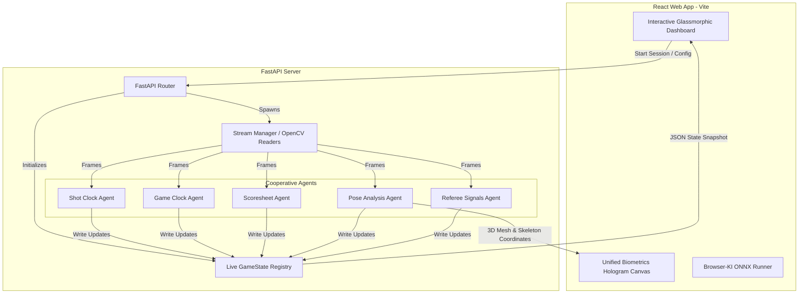

# 🏀 Hoop Stats Pro

> **AI-Powered Basketball Analytics, Live Kampfgericht & Biomechanical 3D Analysis**

Hoop Stats Pro is a state-of-the-art basketball analysis platform designed to automate game statistics, clock management, referee decisions, and player biomechanics. The system operates in two core modes: **Server-Side AI** (Python-based multi-agent pipeline) and **Client-Side AI** (100% in-browser machine learning).

---

## 🌟 Key Features

### 1. 🏟️ Live Kampfgericht (Real-Time AI Board)
An automated scoring and clock management desk powered by cooperative AI agents:
* **Shot Clock Agent:** Automated 24-second timer management with whistle-stop and shot-possession detection.
* **Game Clock Agent:** Precise sync of game clock based on play states.
* **Referee Agent:** Visual violation detection (e.g., out-of-bounds, shot clock violations).
* **Scoresheet Agent:** Automated draft of scoresheets, tracking made/missed shots and active possession.
* **Referee Signals Agent:** Live recognition of official FIBA referee hand gestures.

### 2. 🧍‍♂️ Biomechanics AI (Dual Pose Integration)
Real-time biomechanical telemetry for shooters with a **futuristic 3D Hologram HUD Canvas**:
* **MediaPipe Pose (Lightweight CPU):** Extremely fast, runs on standard processors. Features a neon 3D stick-figure skeleton projection with glowing joint nodes and line connections.
* **DensePose (Detectron2 GPU):** Full 3D body surface mesh segment color-coding, ideal for professional systems with dedicated NVIDIA GPUs (e.g., RTX 4090).
* **Ausfallsicherer Simulations-Modus:** Under Windows or systems without MSVC compilation / GPUs, the server automatically falls back to an advanced MediaPipe simulation that generates a high-fidelity 264-point rotating 3D surface mesh.
* **Centroid Auto-Centering:** Projections calculate coordinates relative to the shooter's center of gravity. The 3D hologram is ALWAYS perfectly framed and in focus, regardless of where the shooter is on the court!

### 3. 📝 Manual Scoreboard & Player Stats
A professional interactive dashboard to manually record points (2PT, 3PT, FT), rebounds, assists, blocks, and turnovers while watching the video. Features full keyboard control and real-time statistics tables.

### 4. 🧪 Browser-KI Benchmark (Client-Side AI)
A proof-of-concept showing full AI analysis running **directly inside the web browser** (no server upload required!). It loads ~20MB ONNX models (YOLO and MediaPipe Pose) directly into the browser memory and performs player/ball tracking and skeleton rendering at high FPS.

---

## 🏗️ Architecture



---

## 🚀 Getting Started

### Prerequisites
* **Python 3.10+** (recommended for virtual environment)
* **Node.js 18+** & npm

### Quick Start (Windows)
We provide automated scripts to set up and run the entire suite instantly:

1. **Installation:**
   Double-click `install.bat`. This will create the Python virtual environment (`venv`), install backend dependencies, and download necessary frontend packages.

2. **Execution:**
   Double-click `run.bat`. This launches:
   * The Python FastAPI backend on `http://localhost:8000`
   * The React development server on `http://localhost:5173` (opens automatically in your browser)

---

### Manual Setup

#### 1. Backend (Python API)
```bash
# Set up virtual environment
python -m venv venv
source venv/bin/activate  # On Windows: venv\Scripts\activate

# Install dependencies
pip install -r requirements.txt

# Start the server
python server.py
```

#### 2. Frontend (React)
```bash
cd frontend-v6
npm install
npm run dev
```

---

## 🔍 Verification & Testing
To ensure the backend agents and trackers are operating correctly, run the automated test suite:
```bash
venv\Scripts\pytest
```
To run the manual pose-agent simulation test run on the sample video:
```bash
venv\Scripts\python run_tests_manual.py
```

---

## 📄 License
This project is developed under the Ethical Saving gUG guidelines. Feel free to contribute or open issues!
