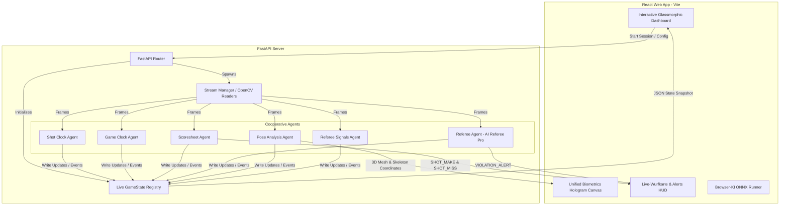

# 🏀 Hoop Stats Pro

> **KI-gestützte Basketball-Analysen, automatisiertes Live-Kampfgericht, AI Referee Pro & biomechanische 3D-Körperanalyse in Echtzeit.**

Hoop Stats Pro ist eine hochmoderne Basketball-Analyseplattform, die darauf ausgelegt ist, Spielstatistiken, Uhrzeitsynchronisation, Schiedsrichterentscheidungen und Spielerbiometrie vollständig zu automatisieren. Das System arbeitet in zwei Kernmodi: **Server-Side AI** (Python-basierte kooperative Multi-Agenten-Pipeline) und **Client-Side AI** (100% lokale KI im Browser).

---

## Realistischer Projektstatus

Das Projekt ist aktuell am ehesten ein **fortgeschrittener technischer Prototyp**: Die Architektur, Tests und UI-Bausteine sind eine gute Grundlage, aber die vollautomatische Erkennung von Spielereignissen, Schiedsrichterzeichen und Regelverstößen ist noch nicht produktionsreif. Realistisch nutzbar sind zuerst:

* manueller Kampfbericht mit Video-Unterstützung,
* Offline-Analyse einzelner Videos,
* experimentelle Tracking-, Wurf- und Telemetrie-Auswertung,
* Modell- und Pipeline-Benchmarks.

Für eine belastbare Live-Automatisierung fehlen vor allem validierte Datensätze aus echten Hallen, robuste Kamerakalibrierung, systematische Modellvergleiche und ein Review-Workflow, der AI-Events vor dem offiziellen Scoring bestätigt.

---

## Dokumentation fuer Entwickler und Agenten

Neue Bearbeiter sollten in dieser Reihenfolge starten:

* [`docs/AGENT_GUIDE.md`](docs/AGENT_GUIDE.md) - Architektur, Agenten-Vertrag, Datenfluss und Entwicklungsregeln.
* [`docs/API_REFERENCE.md`](docs/API_REFERENCE.md) - FastAPI-Routen, Payloads und erwartete Antworten.
* [`docs/ROADMAP.md`](docs/ROADMAP.md) - priorisierte Roadmap mit bereits erledigten und naechsten Schritten.

Diese Dokumente sind bewusst agentenorientiert geschrieben: Sie beschreiben, welche Module stabil sind, wo experimentelle Logik liegt und welche Contracts beim Weiterentwickeln nicht gebrochen werden sollen.

---

## 🌟 Highlights & Features

### 1. 🏟️ Live-Kampfgericht (Echtzeit KI-Board)
Ein vollautomatisiertes Anschreibertisch- und Zeitnehmer-System, gesteuert von kooperativen KI-Agenten:
* **Shot Clock Agent:** Automatisiertes 24/14-Sekunden-Timer-Management mit Pfiff-Erkennung und Ballbesitz-Wechseln.
* **Game Clock Agent:** Präzise Steuerung und Synchronisation der Spielzeituhr basierend auf Spielzuständen.
* **Scoresheet Agent:** Automatisches Ausfüllen des offiziellen Anschreibebogens, Erfassung von Korbwürfen und Assists.
* **Referee Signals Agent:** Live-Gestenerkennung offizieller FIBA-Schiedsrichterzeichen.

### 2. 🛑 AI Referee Pro (Erweiterte Regelüberwachung) `[NEU]`
Der Schiedsrichter-Agent wurde um hochentwickelte Regelheuristiken erweitert, die Bewegungs- und Balltrajektorien in Echtzeit analysieren:
* **Schrittfehler (Traveling):** Zählt die Schritte eines Spielers im Ballbesitz (`HELD`-Status). Bewegt sich der Spieler mehr als 2 Schritte ohne zu dribbeln (Bewegungsschwellenwert > 0,6m), wird sofort ein `VIOLATION_ALERT` ausgelöst.
* **Dribbelfehler (Double-Dribble):** Erkennt unzulässige Dribbling-Wiederaufnahmen (Übergang: `DRIBBLING` -> `HELD` -> erneut `DRIBBLING`) desselben Spielers.
* **Rückspiel (Backcourt Violation):** Erkennt Verstöße gegen die Rückspielregel an der Mittellinie (`x = 14,0m`) basierend auf Ballbesitz und Vorfeld-Etablierung.

### 3. 🏀 Live Shot Map (Interaktive Wurfkarte) `[NEU]`
Das Live-Dashboard verfügt über ein atemberaubendes zentriertes Spielfeld-Widget im exklusiven Glassmorphic-Design:
* **Echtzeit-Plotting:** Würfe werden im selben Moment, in dem sie passieren, als leuchtende Kreise auf den Court projiziert (**Neon-Grün** für Treffer, **Neon-Rot** für Fehlwürfe).
* **Interaktives Feedback:** Hover-Effekte mit weichen Framer-Motion-Animationen zeigen Details zum Schützen, der Zone und der Wurfdistanz.
* **Dynamische Dreier-Erkennung:** Automatische Berechnung und Zuordnung von 3 Punkten, falls der Wurf aus der Drei-Punkte-Zone abgegeben wurde.

### 4. 🧍‍♂️ Biometrics AI (Duales 3D-Körper-HUD)
Echtzeit-Winkel- und Haltungsanalysen des werfenden Spielers in einem futuristischen Hologramm-HUD:
* **MediaPipe Pose (CPU):** Extrem leichtgewichtiges Skelett-Tracking mit 3D-Verbindungen.
* **DensePose (RTX 4090 GPU):** Farbcodiertes 3D-Körperoberflächennetz für professionelle GPU-Systeme.
* **Intelligente Zentrierung:** Automatische Zentrierungsberechnung relativ zum Schwerpunkt des Schützen. Das 3D-Hologramm bleibt immer perfekt fokussiert und im Bildausschnitt.

### 5. 🧪 Browser-KI Benchmark (Client-Side AI)
Ein Machbarkeitsnachweis für lokale In-Browser-KI: Lädt ~20MB große ONNX-Modelle (YOLO und MediaPipe) direkt in den lokalen Arbeitsspeicher des Browsers und führt das Ball- und Spielertracking bei hohen FPS direkt auf der Client-Hardware aus – ganz ohne Server-Upload.

---

## 🏗️ Systemarchitektur

Das Zusammenspiel der kooperativen Agenten und Datenströme:



---

## 🚀 Installation & Schnellstart

### Voraussetzungen
* **Python 3.10+** (inkl. pip)
* **Node.js 18+** (inkl. npm)

### Schnellstart (Windows)
Wir stellen vollautomatisierte Skripte zur schlüsselfertigen Einrichtung bereit:

1. **Einrichtung:**
   Klicke doppelt auf die Datei **`install.bat`**. Dies erstellt die virtuelle Python-Umgebung (`venv`), installiert alle Backend-Abhängigkeiten und lädt die Node-Module für das Frontend herunter.

2. **Starten:**
   Klicke doppelt auf die Datei **`run.bat`**. Dies startet automatisch den FastAPI-Server (`http://localhost:8000`) sowie den React-Vite-Entwicklungsserver (`http://localhost:5173`) und öffnet das Web-Interface in deinem Standardbrowser.

---

### Manuelle Einrichtung

#### 1. Backend (Python API)
```bash
# Virtuelle Umgebung erstellen und aktivieren
python -m venv venv
source venv/bin/activate  # Unter Windows: venv\Scripts\activate

# Abhängigkeiten installieren
pip install -r requirements.txt

# Server starten
python server.py
```

#### Modell-Auswahl
Standardmäßig bevorzugt der Backend-Detektor ein lokal vorhandenes `yolo26n.pt` und fällt danach auf `yolo11n.pt` oder `yolov8n.pt` zurück. Für feste Modellpfade kann der Pfad per Umgebungsvariable überschrieben werden:

```bash
set HOOP_STATS_YOLO_MODEL=yolo26n.pt
set HOOP_STATS_YOLO_FALLBACK=yolov8n.pt
set HOOP_STATS_HOOP_MODEL=models/hoop_detector_yolo11.pt
python server.py
```

Der Server stellt unter `http://localhost:8000/health` den aktuell erkannten Modellstatus bereit. Automatische ONNX/OpenVINO-Exporte sind standardmäßig deaktiviert, damit der Start schnell bleibt. Für bewusstes Pre-Exporting kann `HOOP_STATS_AUTO_EXPORT=1` gesetzt werden.

**YOLO26** ist die sinnvollste nächste Testoption für den Hauptdetektor, weil es auf Edge-/CPU-Inferenz und kleine Objekte optimiert ist. **YOLOE** ist eher als Open-Vocabulary-Werkzeug zum Prototyping und Label-Bootstrapping interessant, zum Beispiel für Prompts wie "basketball rim", "scoreboard" oder "referee signal". Für stabile Live-Statistik sollte am Ende ein feintrainiertes Closed-Set-Modell auf euren Hallenvideos entscheiden.

#### LocateAnything Grounding
LocateAnything ist als optionales Review- und Label-Werkzeug integriert. Es ersetzt nicht den YOLO-Live-Pfad, sondern lokalisiert Objekte oder Text auf Einzelbildern per Prompt und speichert die Ausgabe als JSON unter `results/annotations/`.

Standardmäßig ist der Pfad deaktiviert, damit der Server nicht ungefragt ein großes VLM lädt:

```bash
set HOOP_STATS_GROUNDING_BACKEND=disabled
```

Für einen separaten lokalen vLLM- oder SGLang-Server mit OpenAI-kompatibler API:

```bash
set HOOP_STATS_GROUNDING_BACKEND=openai
set HOOP_STATS_GROUNDING_API_URL=http://127.0.0.1:30000
set HOOP_STATS_GROUNDING_MODEL=nvidia/LocateAnything-3B
python server.py
```

Direkte Transformers-Inferenz im Backend ist ebenfalls möglich, aber nur für passende NVIDIA-GPU-Systeme sinnvoll:

```bash
set HOOP_STATS_GROUNDING_BACKEND=local
set HOOP_STATS_GROUNDING_DEVICE=cuda
set HOOP_STATS_GROUNDING_MODEL=nvidia/LocateAnything-3B
python server.py
```

Der UI-Modus **LocateAnything** akzeptiert Bildframes und unterstützt Prompts wie `basketball rim`, `shot clock`, `scoreboard` oder `referee hand signal`.

#### 2. Frontend (React)
```bash
cd frontend-v6
npm install
npm run dev
```

---

## 🔍 Tests & Verifikation

Das System verfügt über eine umfangreiche Testabdeckung für alle mathematischen Tracking- und Wurfheuristiken:

* **Automatisierte Backend-Tests ausführen:**
  ```bash
  venv\Scripts\python -m pytest
  ```
* **Kompilierungs-Check des Frontends:**
  ```bash
  cd frontend-v6
  npm run build
  ```

---

## 📄 Lizenz
Dieses Projekt wird unter den Richtlinien der **Ethical Saving gUG** entwickelt und gepflegt. Beiträge und Issue-Meldungen sind jederzeit herzlich willkommen!
