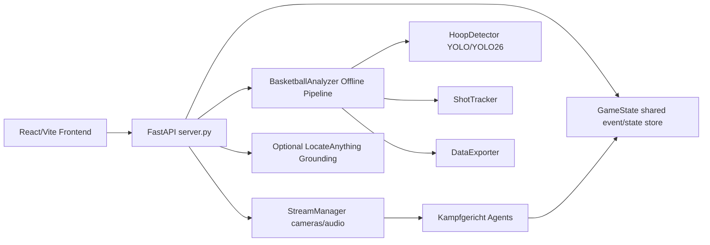

# Hoop Stats Pro Agent Guide

Dieses Dokument ist die technische Einstiegsschicht fuer Menschen und KI-Agenten,
die den Code weiterbearbeiten. Es beschreibt die Runtime-Vertraege, die wichtigsten
Module und die Grenzen des aktuellen Prototyps.

## Projektstatus

Hoop Stats Pro ist ein fortgeschrittener Prototyp fuer Basketball-Videoanalyse und
Live-Kampfgericht. Stabil nutzbar sind aktuell:

- manueller Kampfbericht mit Video-Unterstuetzung,
- Offline-Analyse einzelner Videos,
- experimentelle Live-Agenten auf Stream-Frames,
- optionale LocateAnything-Annotation auf Einzelbildern,
- Frontend-Modi fuer Review, Benchmark und Dashboard.

Nicht als produktionsreif behandeln:

- vollautomatische offizielle Spielstatistik,
- regelverbindliche Schiedsrichterentscheidungen,
- Echtzeitbetrieb ohne menschliche Review-Schicht,
- robuste Generalisierung auf beliebige Hallen/Kameras.

## Architekturueberblick



## Zentrale Module

| Modul | Rolle | Wichtige Hinweise |
| --- | --- | --- |
| `server.py` | FastAPI-Router, Uploads, Jobs, Live-Session Lifecycle | API-Contract stabil halten; keine schweren Modelle beim Import laden. |
| `hoop_stats/analyzer.py` | Offline-Analyse fuer hochgeladene Videos | Nutzt YOLO-Tracking, OCR, Teamfarben, ShotTracker und Exporter. |
| `hoop_stats/detector.py` | Modell-Auswahl und Primitive Detection | Bevorzugt lokale `yolo26n.pt`, fallback auf `yolo11n.pt`/`yolov8n.pt`. |
| `hoop_stats/game_state.py` | Thread-sicherer Live-State und Eventbus | Alle Agenten schreiben hierueber, nie direkt ins Frontend. |
| `hoop_stats/stream_manager.py` | Kamera-/Audio-Reader Threads | Gibt immer den letzten Frame/Chunk zurueck; Quellen koennen Dateien oder Streams sein. |
| `hoop_stats/agents/*` | Live-Kampfgericht-Agenten | Jeder Agent erbt von `BaseAgent` und verarbeitet Frames im eigenen Thread. |
| `hoop_stats/grounding.py` | Optionales LocateAnything/VLM-Grounding | Standard ist deaktiviert; aktiviert via Env-Var. |
| `frontend-v6/src/App.jsx` | Modus-Auswahl und Hauptnavigation | API-Basis kommt aus `VITE_API_BASE_URL`. |
| `frontend-v6/src/components/*` | UI-Werkzeuge und Dashboards | Komponenten sollten API-Fehler sichtbar machen, nicht nur loggen. |

## Agenten-Vertrag

Alle Live-Agenten erben von `BaseAgent`:

1. Konstruktor bekommt `GameState`, `StreamManager`, `camera_ids`, `audio_ids`, `tick_rate`.
2. `process_frame(camera_id, frame, frame_idx)` ist der eigentliche Arbeits-Hook.
3. `on_whistle()` ist optional und wird bei Audio-Pfiff-Erkennung aufgerufen.
4. Agenten sollen Events mit `game_state.append_event(...)` publizieren.
5. Agenten sollen den gemeinsamen Zustand nur unter Methoden/Lock von `GameState` veraendern.
6. Agenten muessen fehlertolerant sein: ein schlechtes Frame darf den Thread nicht beenden.

### Event-Konventionen

Events sind JSON-nahe Datenstrukturen:

```python
game_state.append_event(
    agent="scoresheet",
    event_type="SHOT_MAKE",
    data={"team": "home", "shooter_id": "12", "zone": "3PT Wing"},
    frame_ref=frame_idx,
)
```

Konventionen:

- `agent`: stabiler Agent-Key, identisch mit API/UI-Konfiguration.
- `event_type`: uppercase snake/caps, z.B. `SHOT_MAKE`, `VIOLATION_ALERT`.
- `data`: nur JSON-serialisierbare Werte.
- `frame_ref`: Frame-Index, wenn ein Replay/Highlight moeglich ist.

## API-Gruppen

| Route-Gruppe | Zweck |
| --- | --- |
| `/health` | Modell-, Backend- und Runtime-Status fuer UI und Checks. |
| `/analyze/*` | Datei-Upload, Offline-Analyse, Visualisierung, 3D-Export. |
| `/game/*` | Live-Session starten/stoppen, State, Highlights, Voice-Overrides. |
| `/manual/*` | Manueller Spielbericht, Spielerpflege, Video-Upload. |
| `/grounding/*` | Optionales LocateAnything-Grounding auf Einzelbildern. |
| `/ws/webrtc` | Signaling fuer Browser-basierte Live-Quellen. |

## Modell-Konfiguration

Backend:

```powershell
set HOOP_STATS_YOLO_MODEL=yolo26n.pt
set HOOP_STATS_YOLO_FALLBACK=yolov8n.pt
set HOOP_STATS_HOOP_MODEL=models/hoop_detector_yolo11.pt
set HOOP_STATS_AUTO_EXPORT=0
```

Grounding:

```powershell
set HOOP_STATS_GROUNDING_BACKEND=disabled
set HOOP_STATS_GROUNDING_BACKEND=openai
set HOOP_STATS_GROUNDING_API_URL=http://127.0.0.1:30000
set HOOP_STATS_GROUNDING_MODEL=nvidia/LocateAnything-3B
```

Der Live-Pfad sollte YOLO/Tracker-basiert bleiben. LocateAnything gehoert in den
Offline-Review- und Label-Bootstrap-Pfad.

## Entwicklungsregeln fuer Agenten

- Erst Tests lesen, dann Logik aendern.
- Keine schweren Modelle beim Modulimport laden.
- Neue API-Routen muessen saubere `400`/`503`/`500`-Fehler liefern.
- Upload-Pfade nur ueber sichere Helper in `server.py` erzeugen.
- Jede neue Live-Erkennung muss ein menschlich pruefbares Event erzeugen.
- Keine produktiven Statistikentscheidungen ohne Confidence/Review-Metadaten.
- Frontend-Fehler im UI anzeigen; `console.error` allein reicht nicht.
- Fuer neue Modellpfade Env-Variablen dokumentieren.

## Verifikation

Vor einem Commit:

```powershell
venv\Scripts\python -m pytest -q
cd frontend-v6
npm run lint
npm run build
```

Wenn ein lokaler Server visuell geprueft werden soll:

```powershell
venv\Scripts\python server.py
cd frontend-v6
npm run dev
```

## Bekannte Risiken

- Viele Live-Agenten sind heuristisch und brauchen echte Hallendaten.
- OCR und Trikotfarben sind stark licht- und perspektivabhaengig.
- Ball-Erkennung mit COCO-Sportsball ist fuer Basketball-Videos oft zu schwach.
- `run_fast` nutzt Prozessparallelitaet; unter Windows sind Importkosten relevant.
- LocateAnything kann sehr GPU-/VRAM-lastig sein und sollte separat betrieben werden.
